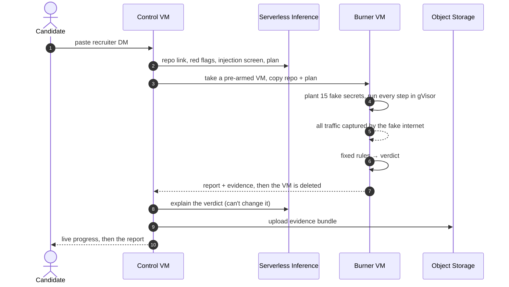

<div align="center">


# Burner

### Run the take-home before it runs you.

Paste a recruiter's message. Burner runs the repo the way a candidate would, inside a throwaway Vultr VM full of
fake secrets, and shows you exactly what it tried to steal before the VM is destroyed.

[**Live app**](https://139-84-215-1.sslip.io) &nbsp;·&nbsp; [Track record](https://139-84-215-1.sslip.io/track) &nbsp;·&nbsp; [Benchmark](reports/benchmark/results.md) &nbsp;·&nbsp; [Deck](pitch/Burner-deck.pdf)


<sub>Vultr Agent Rush · lablab.ai · Track 1: Blast Radius Zero</sub>

<br>


<br>

| **13 / 13** | **0 / 21** | **112 s** | **< $0.01** |
| :---: | :---: | :---: | :---: |
| campaign-style samples caught<br><sub>static GuardDog: 11 / 13</sub> | false alarms on real public repos<br><sub>after one rule fix</sub> | paste to verdict<br><sub>warm VM, LLM included</sub> | per scan<br><sub>one VM, then deleted</sub> |

</div>

<br>

> [!IMPORTANT]
> Every secret Burner plants is fake, and every malicious sample here is a defanged reconstruction written from public
> threat reports. The samples only talk to documentation IP ranges and `*.example` names, and inside the sandbox all
> traffic goes to Burner's fake internet anyway.

<br>

## The problem

North Korea's **Contagious Interview** campaign sends developers fake take-home tests. The repo looks like a normal
app. The payload runs when you do exactly what the recruiter asked: open it in VS Code, `npm install`, `npm start`.

<p align="center"></p>

| | |
| --- | --- |
| **30,000+ devices, 7,000+ wallets drained** | Joint advisory from seven agencies in four countries, Sep 2026 |
| **$308M** | Stolen from DMM Bitcoin after one employee's GitHub "pre-employment test" |
| **0 antivirus detections** | Elastic's July 2026 variant, which runs at `npm start` and keeps running inside VMs |
| **1,700+ packages, 750+ repos** | Socket and Trend Micro. Victims committed the malware into their employers' repos |

The FBI's advice is *"insist on using a virtual machine."* A VM contains the damage, but it can't tell you the repo
was malicious, so you can't warn anyone. Burner does both.

<br>

## Why this problem

I chose it from **24 candidate problems**, using two scored rounds and then adversarial validation, where parallel
research passes tried to *disprove* each problem. Burner was the most genuine and least solved problem left standing
([reports](reports)).

- **Running beats reading.** In the OSCAR paper (ASE 2024), running npm packages caught **459 of 500** malicious ones with 3 false positives. Static GuardDog caught **338**, with 28. This campaign hides payloads in assets, in `npm test` and behind timers, precisely to beat reading.
- **The pieces exist, the product doesn't.** Socket and Aikido block known-bad packages, Tracebit plants fake secrets, and the FBI says to use a VM. Open-source experiments are starting. Nobody has put the whole puzzle together in a candidate's hands.
- **The market is real.** Socket ($1B valuation, May 2026), Aikido ($1B, Jan 2026), Tracebit ($20M, Mar 2026), Koi (acquired by Palo Alto Networks).
- **It is Track 1, literally.** Isolation becomes the detonation chamber, "no secrets" becomes fake secrets as bait, limits become the run budget, and destroy-after becomes a line on the receipt.

<br>

## How it works

<p align="center"></p>

<p align="center"></p>

1. **Read.** Vultr Serverless Inference pulls the repo link and the red flags out of the recruiter's DM. The repo is cloned with git hooks and symlinks off, and nothing in it runs on the control VM.
2. **Plan.** Burner builds a candidate's steps (VS Code `folderOpen` tasks, install, start, test, `python main.py`). The LLM adds up to 4 steps from the README, which it treats as untrusted data.
3. **Detonate.** A pre-armed Vultr VM runs every step inside gVisor with **15 fresh fake secrets** and a fake internet. Then it runs again with the clock moved 45 days forward.
4. **Judge.** Fixed rules match every planted secret against all captured traffic, whether plain, base64, hex, gzip, XOR or DNS-tunnelled. **The LLM never sets the verdict.**
5. **Destroy.** The VM is deleted through the Vultr API, the LLM explains the result in plain English, and the evidence goes to Object Storage.

<details>
<summary><b>The verdict rules</b></summary>
<br>
<p align="center"></p>

**MALICIOUS** means a planted secret was seen leaving, or a secret file was read (or downloaded code was run) **and** an
unknown host was contacted. **SUSPICIOUS** means any high finding (persistence, secret read, remote code, crashed
sandbox) or two medium ones. **INCONCLUSIVE** means nothing actually ran. Anything else is **NO MALICIOUS BEHAVIOUR
OBSERVED**, which is not the same as *safe*.

</details>

<details>
<summary><b>The full sequence</b></summary>
<br>



</details>

<br>

## Results

<table>
<tr>
<td width="50%" valign="top">

**Benchmark** · 13 malicious, 11 clean

| | Burner | GuardDog |
| --- | :---: | :---: |
| Detected | **13 / 13** | 11 / 13 |
| False alarms | **0 / 11** | 1 / 11 |
| Median time | 91 s | 0.8 s |

GuardDog missed the time bomb and the XOR-obfuscated loader. [Per-sample table →](reports/benchmark/results.md)

</td>
<td width="50%" valign="top">

**Real public repos** · 21 by other people

| | |
| --- | :---: |
| False alarms | **0 / 21** |
| No malicious behaviour | 19 |
| Inconclusive | 2 |

Express, NestJS, Remix, Next.js, FastAPI and more. The first run had 2 pm2 false alarms, fixed. [Details →](reports/benchmark/real-repos.md)

</td>
</tr>
</table>

**Live scan on the deployed app** (case `4f5efb8dc6`): MALICIOUS. 10 of 15 fake secrets were sent to
`203.0.113.55:1224` and `cdn-telemetry.example`. The VM was alive 255 s and cost **$0.0019**.

> [!NOTE]
> I wrote all 24 benchmark samples from public reports, and some rules were tuned after the first run (baseline:
> 11/12 detected, 1/11 false alarms). Treat the numbers as a regression suite, not a field study.

<br>

## Containment

<p align="center"></p>

A red-team repo run as the take-home couldn't reach the internet, DNS, cloud metadata, the host's SSH, the Docker
socket, the host kernel, or root. **0 packets left the sandbox.** A memory bomb can still kill the sandbox (not the
host), and the verdict then becomes SUSPICIOUS, never clean. [Raw results →](reports/benchmark/containment.json)

<br>

## The product

<table>
<tr>
<td width="50%"><p align="center"><sub><b>Live run</b>: every phase streams in as the VM reports it</sub></p></td>
<td width="50%"><p align="center"><sub><b>Verdict</b>: decided by rules, with receipts</sub></p></td>
</tr>
<tr>
<td width="50%"><p align="center"><sub><b>What it stole</b>: every fake secret and where it went</sub></p></td>
<td width="50%"><p align="center"><sub><b>What the repo did</b>, including the +45-day rerun</sub></p></td>
</tr>
</table>

<br>

## Quick start

```bash
git clone https://github.com/Maheswar-Sah00/burner.git && cd burner
pip install fastapi "uvicorn[standard]" boto3 pydantic

# the UI with no cloud at all: replays a recorded scan
BURNER_MOCK=1 python -m uvicorn burner.web.app:app --port 8000
```

<details>
<summary><b>Real scans, deploy and benchmarks</b></summary>
<br>

Put `VULTR_API_KEY`, `VULTR_INFERENCE_KEY` and `BURNER_POOL_SIZE=1` in `.env`, then create an SSH key with
`ssh-keygen -t ed25519 -f .burner/id_ed25519 -N ""`. The API key's access list must include your IP.

```bash
python -m burner.control.scan --message samples/recruiter-message.txt   # from a recruiter DM
python -m burner.control.scan https://github.com/owner/repo --no-llm     # a repo, rules only
python deploy/deploy.py                                                  # control VM + HTTPS + reaper
python -m burner.bench.run_bench --label final                           # vs GuardDog
python -m burner.bench.real_repos                                        # false-alarm check
python -m pytest -q                                                      # 32 tests
```

</details>

<details>
<summary><b>Repo layout</b></summary>
<br>

```
burner/control/   scan orchestrator · Vultr API + warm pool + reaper · Serverless Inference · evidence → Object Storage
burner/node/      runs on the burner VM: gVisor + iptables setup · fake secrets · fake internet · candidate steps · rules
burner/web/       FastAPI + live progress (SSE) · UI · recorded replays
burner/bench/     benchmark vs GuardDog · real-repo check
samples/          defanged stealers, a clean take-home, a red-team escape repo, a recruiter message
docs/diagrams/    Excalidraw sources (.excalidraw) + SVG exports
```

</details>

<br>

## Limits

Burner reports what it **observed in one run**. It can miss malware that detects the sandbox and stays quiet,
payloads that need a real reply from the attacker's server, time bombs set beyond +45 days, triggers that need a UI
click, and stacks other than JavaScript and Python. A clean result means *nothing malicious was observed*, not *safe*.

<br>

<details>
<summary><b>Sources</b></summary>
<br>

- Joint WaterPlum advisory, Sep 2026: [BleepingComputer](https://www.bleepingcomputer.com/news/security/north-korean-waterplum-hackers-infected-30-000-devices-worldwide/) · [The Record](https://therecord.media/north-korean-hackers-infect-thousands-of-devices-waterplum-scheme)
- DMM Bitcoin, $308M: [BleepingComputer](https://www.bleepingcomputer.com/news/security/fbi-links-north-korean-hackers-to-308-million-crypto-heist)
- Elastic Security Labs, Jul 2026: [Elastic](https://www.elastic.co/security-labs/threat-command/contagious-interview-malware-svg-steganography)
- Socket, Apr 2026: [Socket](https://socket.dev/blog/contagious-interview-campaign-spreads-across-5-ecosystems) · Trend Micro, Mar 2026: [Trend Micro](https://www.trendmicro.com/en_gb/research/26/d/void-dokkaebi-uses-fake-job-interview-lure-to-spread-malware-via-code-repositories.html) · Atlassian, Sep 2026: [Atlassian](https://www.atlassian.com/blog/bitbucket/disrupting-contagious-interview)
- FBI IC3 PSA, Sep 2024: [IC3](https://www.ic3.gov/PSA/2024/PSA240903)
- OSCAR, ASE 2024: [arXiv](https://arxiv.org/html/2409.09356v1)
- Market: [Socket](https://socket.dev/blog/socket-raises-60m-series-c-press-release) · [Aikido](https://siliconangle.com/2026/01/14/aikido-security-raises-60m-series-b-1b-valuation-unify-application-security/) · [Tracebit](https://tech.eu/2026/03/17/tracebit-raises-20m-series-a-to-expand-cloud-native-deception-tech/)

</details>

<br>

<div align="center">

<sub>Built solo by <a href="https://github.com/Maheswar-Sah00">@Maheswar-Sah00</a> on Vultr Cloud Compute, Serverless Inference and Object Storage · gVisor · FastAPI · Caddy · D3 · Geist</sub>

</div>
