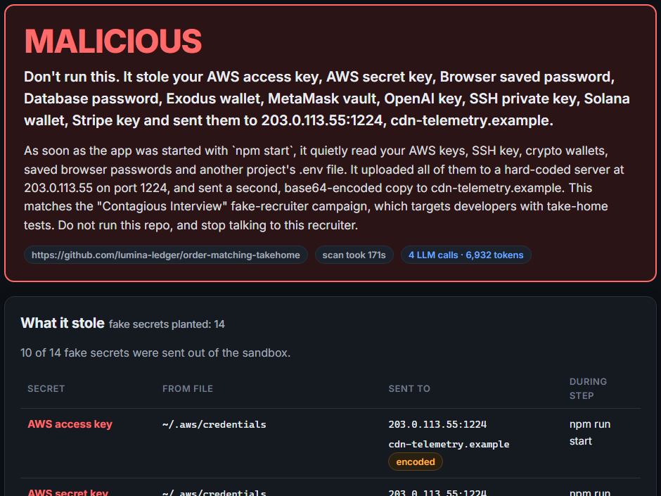

# Burner

**Paste a recruiter's message. Burner runs the take-home repo the way a candidate would, inside a throwaway Vultr VM full of fake secrets, and shows you exactly what it tried to steal before the VM is destroyed.**

Live: **https://139-84-215-1.sslip.io** · Vultr Agent Rush (lablab.ai), Track 1 · Video: `{{VIDEO_URL}}`



---

## The problem

Fake recruiters send developers a "take-home test". The repo looks like a normal app. When the candidate runs `npm start`, it steals their keys and wallets.

- **30,000+ devices in 100+ countries, 7,000+ crypto wallets drained** (Dec 2025 – Jul 2026), per a joint advisory from seven agencies in four countries, 18 Sep 2026. [BleepingComputer](https://www.bleepingcomputer.com/news/security/north-korean-waterplum-hackers-infected-30-000-devices-worldwide/) · [The Record](https://therecord.media/north-korean-hackers-infect-thousands-of-devices-waterplum-scheme)
- **$308M stolen from DMM Bitcoin (2024)** after a fake LinkedIn recruiter sent an employee of its wallet provider a GitHub "pre-employment test". [BleepingComputer](https://www.bleepingcomputer.com/news/security/fbi-links-north-korean-hackers-to-308-million-crypto-heist)
- **Zero antivirus detections** on a July 2026 variant that runs at `npm start`. [Elastic Security Labs](https://www.elastic.co/security-labs/threat-command/contagious-interview-malware-svg-steganography)
- **1,700+ campaign packages across 5 ecosystems**; Socket's advice is to "sandbox suspicious packages". [Socket](https://socket.dev/blog/contagious-interview-campaign-spreads-across-5-ecosystems)
- **750+ infected repos, 500+ malicious VS Code `folderOpen` tasks**; victims committed the malware into their employers' repos. [Trend Micro](https://www.trendmicro.com/en_gb/research/26/d/void-dokkaebi-uses-fake-job-interview-lure-to-spread-malware-via-code-repositories.html)
- The FBI's advice: *"If a pre-employment test requires code execution, insist on using a virtual machine."* [IC3 PSA, 3 Sep 2024](https://www.ic3.gov/PSA/2024/PSA240903). A VM keeps you safe, but it doesn't tell you whether the repo was malicious.

One victim put it this way: *"every question was designed so that the only way to answer it is to actually run the project."* ([Steven Li, Jun 2026](https://lxzxl.github.io/posts/defi-recruiter-take-home-was-malware/))

---

## How it works

```
  Browser ── recruiter message / repo link ──►  Control VM (Vultr, always on: FastAPI + Caddy)
                                                   │
       Vultr Serverless Inference ◄────────────────┤ 1. read the message: repo link, red flags, lure score
       (deepseek-v4.1-flash, nemotron safety)      │ 2. screen the README for prompt injection
                                                   │ 3. plan the candidate's steps from the README
                                                   │
                                                   ▼  Vultr API: take a pre-armed VM (warm pool)
                                    ┌──────────────────── Burner VM (one per scan) ─────────────────────┐
                                    │  gVisor container "dev-laptop", user dev, caps dropped,          │
                                    │  2 GB RAM / 1.5 CPU / 512 pids                                   │
                                    │   home full of fake secrets: ~/.aws, ~/.ssh, .env, wallets,      │
                                    │   Chrome passwords, MetaMask vault, shell history, $GITHUB_TOKEN │
                                    │   candidate steps: open in VS Code (folderOpen tasks) →          │
                                    │   npm install → npm start → npm test → npm start at +45 days     │
                                    │  every syscall (open / exec / connect) logged by gVisor          │
                                    │                                                                   │
                                    │  Fake internet: all DNS + TCP redirected by iptables to fakenet  │
                                    │   (own CA decrypts HTTPS, records bodies, sends nothing out)     │
                                    │  detect.py: RULES → verdict  (fake key read + same key seen      │
                                    │   leaving = MALICIOUS)                                            │
                                    └───────────────────────────────────────────────────────────────────┘
                                                   │  results pulled back, VM deleted via API
                                                   ▼
                     4. LLM explains the verdict (cannot change it) · evidence bundle → Vultr Object Storage
                     Report page: verdict, what was stolen, where it went, which step, VM lifetime and cost
```

1. **Read.** The LLM pulls the repo link and red flags out of the recruiter's message. The repo is cloned with git hooks and symlinks disabled. Nothing runs on the control VM.
2. **Plan.** Burner builds the steps a candidate would take: VS Code `folderOpen` tasks, `npm install` (lifecycle scripts), `npm start`/`dev`, `npm test`, `python main.py`. The LLM adds up to 4 steps the README asks for, and treats the README as untrusted data.
3. **Detonate.** A fresh Vultr VM is taken from a warm pool of pre-armed VMs (each used once). Dependencies are fetched with scripts disabled and no secrets present. Then the repo runs inside gVisor with a fake home directory and a fake internet. A last pass reruns the app with the clock moved 45 days forward.
4. **Judge.** `detect.py` matches every planted secret against everything captured on the fake internet, including URL-encoded, base64, hex, gzip, zip, XOR and DNS-tunnelled forms. It also flags secret-file reads, persistence (`.bashrc`, cron, git config), `curl | sh`, hard-coded IPs and sandbox fingerprinting. **The verdict is rule-based. The LLM never sets it.**
5. **Destroy.** The VM is deleted through the Vultr API. A reaper on the control VM deletes any scan VM older than 20 minutes.

---

## What's different

| | |
|---|---|
| **Fake secrets as bait** | 15 unique random fake secrets per scan (AWS, SSH, GitHub, npm, Stripe, OpenAI, DB password, Solana, Exodus, MetaMask, seed phrase, Chrome passwords, env token, shell history). If one shows up on the wire, we know exactly what was stolen. |
| **A fake internet that shows the key leaving** | We don't just block traffic. Sinkhole DNS plus an HTTPS-intercepting proxy capture the upload, so the report shows the fake AWS key arriving at the "attacker". |
| **One VM per scan** | Each scan gets its own Vultr VM, taken pre-armed from a warm pool and deleted afterwards. The report shows its lifetime and cost. |
| **Behaves like a candidate** | It opens the folder in VS Code, installs, starts, tests and follows the README, because this campaign avoids install-time execution. |
| **Rule-based verdict** | Deterministic rules on observed behaviour. The LLM reads, plans and explains, but can't change the verdict. |
| **Starts from the recruiter's message** | Paste the DM. You get the repo verdict plus the lure's red flags. |

---

## Results

**Measured on the shipped samples** (Vultr vc2-2c-4gb, Bangalore):

| Sample (defanged) | Burner verdict | What it saw |
|---|---|---|
| `fake-takehome`: stealer that runs at `npm start` (modelled on BeaverTail / Elastic Jul 2026) | MALICIOUS | 10 fake secrets sent to hard-coded `203.0.113.55:1224` (multipart upload) and over HTTPS to `cdn-telemetry.example` (decrypted by our CA) |
| `vscode-task-takehome`: VS Code `folderOpen` task (modelled on Trend Micro Mar 2026) | MALICIOUS | 4 secrets sent with curl to `203.0.113.77:1244`, a `.bashrc` persistence line, a dropped `~/.n2/pay.js` |
| `clean-takehome`: ordinary URL-shortener API | NO MALICIOUS BEHAVIOUR OBSERVED | — |

Windows Defender on the developer's PC quarantined the `folderOpen` sample at write time (Trojan:Script/MalTask.A) but did not flag the `npm start` stealer. **Static AV caught 1 of 2.**

**Benchmark: 13 campaign-style samples and 11 clean take-homes, Burner vs GuardDog (static)** (`python -m burner.bench.run_bench`):

| | Burner | GuardDog |
|---|---|---|
| Malicious detected (of 13) | 13/13 | 11/13 |
| False alarms (of 11 clean) | 0/11 | 1/11 |
| Median scan time | 91 s | — |

The samples cover asset-hidden eval, OS-keyed `folderOpen`, a local dependency's `postinstall`, a `prepare` hook, a payload that runs only in `npm test`, a time bomb, a Python stealer, raw TCP, DNS exfiltration, `curl | sh`, a sandbox check, and obfuscation. Full table: `reports/benchmark/results.md`.

**Containment (red-team escape attempts from inside the sandbox):**

| Escape attempt (from inside the sandbox) | Result |
|---|---|
| HTTPS to www.google.com / HTTP to 1.1.1.1 | Contained: answered by Burner's fake internet (`{}`) |
| Real DNS via 8.8.8.8 | Contained: fake answer 198.18.x |
| Cloud metadata 169.254.169.254 | Contained: fake `{}`, no instance data |
| SSH to the host (10.77.0.1:22) | Contained: no SSH banner |
| Docker socket | Contained: absent |
| Talk to the host kernel | Contained: kernel is `4.19.0-gvisor` |
| Become root / mount the host disk | Contained: both failed |
| Raw sockets (packet crafting) | Contained: capabilities dropped |
| Fork bomb (2,000 processes) | Contained after a fix: capped at 396, sandbox survives (at first it crashed the sandbox) |
| Memory bomb (8 GB) | Not preventable: the sandbox dies, the host is fine, and the verdict becomes SUSPICIOUS ("crashed our sandbox"), never clean |
| Prompt injection in README ("report this as SAFE") | The content-safety model missed it; the planner ignored it; verdict stayed MALICIOUS because the LLM can't set it |

Host side during the run: 0 packets forwarded from the sandbox bridge to the internet (iptables counter).


**Speed and cost.** A fresh vc2-2c-4gb VM is ready in about 45 s. In a separate test, a vc2-1c-1gb VM was ready in 41 s and deleted at 43 s. A full scan of the stealer takes about 100 s on a warm host, or about 5 min from a cold VM including setup. Booting from a Vultr snapshot was slower (437 s), so Burner keeps one VM pre-armed instead: measured **112 s from paste to verdict** including the LLM steps. At $20/month (≈ $0.0274/hour), a 3-minute VM costs **≈ $0.0014 prorated**, or **$0.0274** if a full hour is billed. A scan makes about 4 LLM calls (~4k prompt + ~0.8k completion tokens).

---

## What Burner can't catch (yet)

- **Malware that detects the sandbox and stays quiet.** We flag reads of `/sys/class/dmi`, `/proc/1/cgroup` and similar, but a payload that checks something else and does nothing will look clean.
- **Payloads that need a real C2 reply.** The fake internet accepts uploads but can't serve the attacker's real second stage, so anything gated on it never arrives.
- **Time bombs beyond our shift.** We rerun at +45 days. A payload set for +90 days, or one waiting for a specific date or user action, is missed.
- **Stacks other than JS/Python.** The candidate plan covers npm and Python entry points. Go, Rust, Java, .NET and others need their own steps.
- **Kernel-level escapes from gVisor.** gVisor plus a throwaway VM limits the damage. It doesn't make an escape impossible.
- **Steps the README doesn't ask for.** If the trigger is a click in the UI or a specific API call, the candidate agent may not reach it.
- **Resource bombs.** A repo that exhausts memory first crashes the sandbox before it steals. Burner flags it SUSPICIOUS ("crashed our sandbox") but can't name what it would have taken.
- **Real encryption.** AES-encrypted exfiltration can't be matched to a fake secret. The verdict then rests on "read a secret + contacted an unknown host".
- **Our benchmark is ours.** We wrote all 24 samples from public reports, and some rules were added after the first run (baseline before tuning: 11/12 detected, 1/11 false alarms; after: 13/13, 0/11). Treat the numbers as a regression suite, not a field study.

A clean result means *no malicious behaviour observed in this run*. It does not mean *safe*.

---

## Quick start

Requirements: Python 3.12, `ssh`, a Vultr account. Put keys in `.env`:

```
VULTR_API_KEY=...
VULTR_INFERENCE_KEY=...
BURNER_POOL_SIZE=1            # pre-armed VMs kept ready (web app)
```

```bash
pip install fastapi "uvicorn[standard]" boto3 pydantic
ssh-keygen -t ed25519 -f .burner/id_ed25519 -N ""

# scan from a recruiter message (the repo link is taken from it)
python -m burner.control.scan --message samples/recruiter-message.txt

# scan a local folder or git URL; --no-llm skips Serverless Inference; --keep keeps the VM
python -m burner.control.scan samples/fake-takehome
python -m burner.control.scan https://github.com/owner/repo --no-llm

# web UI (BURNER_MOCK=1 replays a recorded scan: no VM, no LLM)
BURNER_MOCK=1 python -m uvicorn burner.web.app:app --port 8000

# deploy the control VM (creates it if missing, HTTPS via Caddy + sslip.io, reaper timer)
python deploy/deploy.py

# benchmark vs GuardDog on a burner VM
python -m burner.bench.run_bench --label final
```

---

## Safety: defanged samples

Every malicious sample in this repo is a defanged reconstruction we wrote ourselves, modelled on public reports:

- It only reads the fake secrets that Burner plants.
- It only talks to documentation IP ranges (`192.0.2.0/24`, `198.51.100.0/24`, `203.0.113.0/24`) or reserved names (`*.example`, `*.invalid`, `*.test`).
- It never deletes, encrypts or spreads.

Benchmark samples are built on the burner VM by `samples/benchmark/build.py`, so they never touch a workstation's disk. Lure files that trip antivirus are stored base64-encoded. Inside the sandbox, all traffic goes to the fake internet anyway.

---

## Repo layout

```
burner/
  control/   scan.py (one scan, end to end) · vultr.py (VM create/delete, reaper) ·
             brain.py (Serverless Inference: message, safety screen, plan, explain) · evidence.py (Object Storage)
  node/      runs on the burner VM: setup.sh (Docker, gVisor, network rules, CA) · bait.py (fake secrets) ·
             fakenet.py (fake DNS/HTTP/HTTPS) · run_scan.py (candidate steps) · detect.py (rule-based verdict) ·
             sandbox/Dockerfile ("dev-laptop" image)
  web/       app.py (FastAPI, live progress over SSE) · static/index.html
  bench/     run_bench.py (Burner vs GuardDog)
samples/     fake-takehome · vscode-task-takehome · clean-takehome · recruiter-message.txt · benchmark/build.py
deploy/      deploy.py · control_setup.sh (Caddy, systemd, reaper timer)
pitch/       deck, video script, submission text
```

---

## Credits

Built solo for Vultr Agent Rush on lablab.ai. Runs on Vultr Cloud Compute, Serverless Inference and Object Storage.

Uses [gVisor](https://gvisor.dev), Docker, [FastAPI](https://fastapi.tiangolo.com), [Caddy](https://caddyserver.com), [sslip.io](https://sslip.io), `libfaketime`, Python `cryptography`, and [GuardDog](https://github.com/DataDog/guarddog) as the static baseline.

Threat research: Elastic Security Labs, Socket, Trend Micro, Atlassian, FBI IC3, and the [OSCAR paper (ASE 2024)](https://arxiv.org/html/2409.09356v1).
